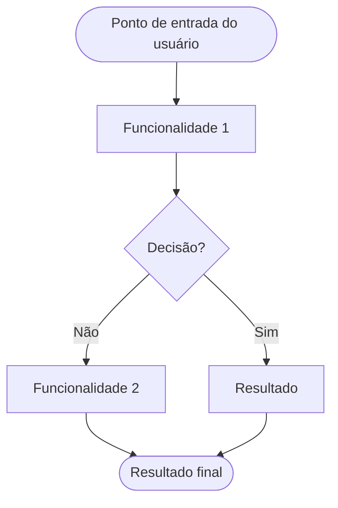

<!-- docqui: {{VERSION}} | prompt: {{PROMPT_ID}} | atualizado: {{YYYY-MM-DD}} -->
# Agrupamento Funcional: [Nome do Agrupamento Funcional]
> **Nível 2** - Domínio: [Nome do Domínio] - `[SIGLA]-[SAF]`

## Descrição
[Descrição em 2-3 frases do que este Agrupamento Funcional faz.]

**Não faz**: [o que está explicitamente fora do escopo.]

---

## Funcionalidades

<!-- Primeira atribuição: confirme a jornada e numere somente as entradas sem ID com scripts/ids-n3.mjs (modo seco, depois --write). IDs existentes são imutáveis; novas funcionalidades continuam após o maior reservado. Preserve o registro docqui:n3-ids quando ele for criado. Ver engine/N3-IDS.md. -->

| Funcionalidade | Descrição |
|---|---|
| [**Nome da Funcionalidade**](f-[verbo]-[entidade].md) <small>[SIGLA]-[SAF]-01</small> | [descrição em uma linha] |

---

## Fluxo Principal

---

## Dependências entre funcionalidades

[lista descrevendo pré-requisitos e relações entre as funcionalidades]

---

## Telas

| Tela | Rota sugerida | Funcionalidades atendidas | Descrição |
|---|---|---|---|
| [Nome da tela] | `/[rota]` | **[Nome da Funcionalidade]** <small>[SIGLA]-[SAF]-01</small> | [o que a tela mostra] |

---

## Permissões por perfil

> **Fonte única de permissões** deste Agrupamento Funcional. As funcionalidades (N3) não tratam de
> perfis nem permissões — qualquer acesso novo ou diferente entra nesta matriz.

Perfis: **[Perfil A]**, **[Perfil B]**, **[Perfil C]**.

| Perfil | [Ação 1] | [Ação 2] | [Ação 3] |
|---|---|---|---|
| **[Perfil A]** | ✓ | ✓ | ✓ |
| **[Perfil B]** | ✓ | — | ✓ |
| **[Perfil C]** | ✓ | — | — |

* **[Perfil A]** — [nível de acesso em uma linha].

---

## Changelog

<!-- Ordem decrescente por data: a entrada mais recente fica sempre no topo, logo abaixo do cabeçalho. -->

| Data | Autor | Tipo | Descrição |
|---|---|---|---|
| [AAAA-MM-DD] | [autor] | N2 criado | Gerado pelo PROMPT 2A |

---

*Links: [N1 do domínio](../README.md) · [INDEX geral](../../INDEX.md)*
