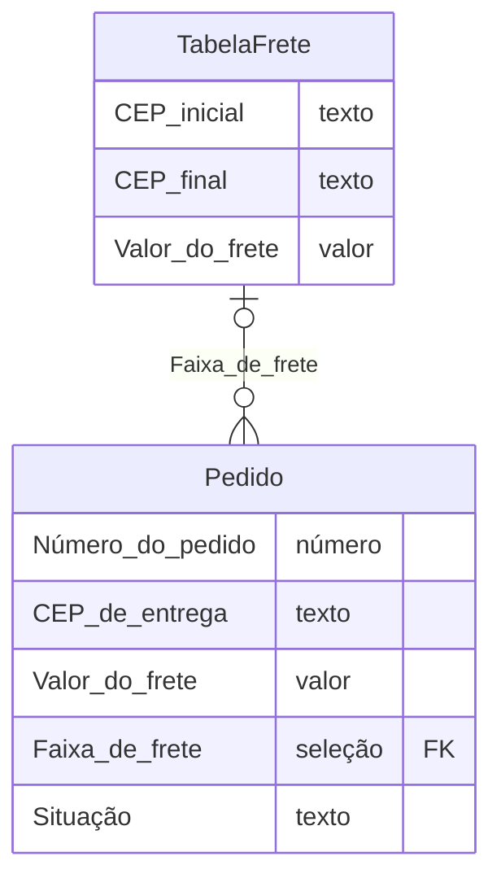

<!-- gerado por scripts/gera-diagrama-er.mjs a partir de global/data-models/*.md — não editar à mão -->
# Diagrama ER
> Um diagrama por domínio, derivado dos fragmentos de `global/data-models/`. A fonte é o fragmento: mude lá e rode `node scripts/gera-diagrama-er.mjs`. Os campos globais implícitos ficam de fora, como no fragmento; entidade de outro domínio aparece como caixa vazia.

## Vendas

Fonte: [`data-models/vendas.md`](./data-models/vendas.md)

