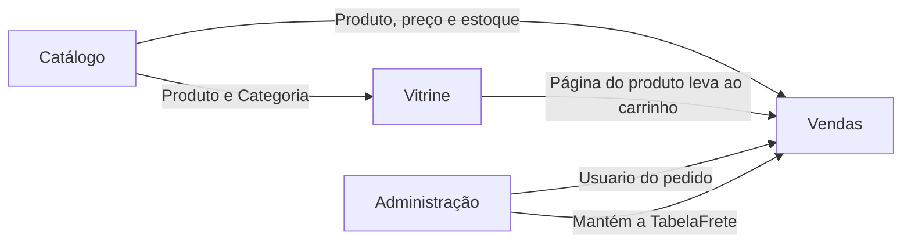

<!-- docqui: 7.0.0 | prompt: MIGRA_NIVEIS | atualizado: 2026-10-21 -->
# Índice geral de módulos — Loja ACME
> Exemplo preenchido de requisitos, ainda sem aprovação humana ou contagem revisada.

## Domínios

| Domínio | SIGLA | Pasta | Responsabilidade | Agrupamentos Funcionais | Status |
|---|---|---|---|---|---|
| [Catálogo](catalogo/README.md) | CAT | `modules/catalogo/` | Produtos à venda e as categorias que os organizam | 1 especificado (Categorias); Produtos planejado | Rascunho didático |
| [Vitrine](vitrine/README.md) | VIT | `modules/vitrine/` | Destaques, busca e página do produto | 2 especificados (Navegação, Destaques) | Rascunho didático |
| [Vendas](vendas/README.md) | VND | `modules/vendas/` | Carrinho, checkout e gestão de pedidos | 3 especificados (Carrinho, Checkout, Gestão de Pedidos) | Rascunho didático |
| [Administração](administracao/README.md) | ADM | `modules/administracao/` | Usuários e faixas de frete | 2 especificados (Usuários, Faixas de Frete) | Rascunho didático |

## Rastreabilidade: ticket → spec → código

| Ticket (AIMM) | Funcionalidade | Domínio | Status | Contagem | PF | CFP | Repositórios |
|---|---|---|---|---|---|---|---|
| [`STRY0013101`](../analise-impacto/AIMM-STRY0013101.md) | [VND-CHK-01: Calcular Frete](vendas/checkout/f-calcular-frete.md) | Vendas | ✏️ Rascunho | 📋 | — | — | — |
| [`STRY0013170`](../analise-impacto/AIMM-STRY0013170.md) | [CAT-CTG-01: Pesquisar Categorias](catalogo/categorias/f-pesquisar-categoria.md) | Catálogo | ✏️ Rascunho | 📋 | — | — | — |
| [`STRY0013170`](../analise-impacto/AIMM-STRY0013170.md) | [CAT-CTG-02: Cadastrar Categoria](catalogo/categorias/f-cadastrar-categoria.md) | Catálogo | ✏️ Rascunho | 📋 | — | — | — |
| [`STRY0013170`](../analise-impacto/AIMM-STRY0013170.md) | [CAT-CTG-03: Editar Categoria](catalogo/categorias/f-editar-categoria.md) | Catálogo | ✏️ Rascunho | 📋 | — | — | — |
| [`STRY0013170`](../analise-impacto/AIMM-STRY0013170.md) | [CAT-CTG-04: Excluir Categoria](catalogo/categorias/f-excluir-categoria.md) | Catálogo | ✏️ Rascunho | 📋 | — | — | — |
| [`STRY0013170`](../analise-impacto/AIMM-STRY0013170.md) | [CAT-CTG-05: Visualizar Categoria](catalogo/categorias/f-visualizar-categoria.md) | Catálogo | ✏️ Rascunho | 📋 | — | — | — |
| [`STRY0013175`](../analise-impacto/AIMM-STRY0013175.md) | [VIT-NAV-01: Listar Destaques](vitrine/navegacao/f-listar-destaque.md) | Vitrine | ✏️ Rascunho | 📋 | — | — | — |
| [`STRY0013175`](../analise-impacto/AIMM-STRY0013175.md) | [VIT-NAV-02: Pesquisar Produtos na Vitrine](vitrine/navegacao/f-pesquisar-produto-vitrine.md) | Vitrine | ✏️ Rascunho | 📋 | — | — | — |
| [`STRY0013175`](../analise-impacto/AIMM-STRY0013175.md) | [VIT-NAV-03: Visualizar Produto na Vitrine](vitrine/navegacao/f-visualizar-produto-vitrine.md) | Vitrine | ✏️ Rascunho | 📋 | — | — | — |
| [`STRY0013180`](../analise-impacto/AIMM-STRY0013180.md) | [VIT-DST-01: Pesquisar Destaques](vitrine/destaques/f-pesquisar-destaque.md) | Vitrine | ✏️ Rascunho | 📋 | — | — | — |
| [`STRY0013180`](../analise-impacto/AIMM-STRY0013180.md) | [VIT-DST-02: Cadastrar Destaque](vitrine/destaques/f-cadastrar-destaque.md) | Vitrine | ✏️ Rascunho | 📋 | — | — | — |
| [`STRY0013180`](../analise-impacto/AIMM-STRY0013180.md) | [VIT-DST-03: Editar Destaque](vitrine/destaques/f-editar-destaque.md) | Vitrine | ✏️ Rascunho | 📋 | — | — | — |
| [`STRY0013180`](../analise-impacto/AIMM-STRY0013180.md) | [VIT-DST-04: Excluir Destaque](vitrine/destaques/f-excluir-destaque.md) | Vitrine | ✏️ Rascunho | 📋 | — | — | — |
| [`STRY0013180`](../analise-impacto/AIMM-STRY0013180.md) | [VIT-DST-05: Visualizar Destaque](vitrine/destaques/f-visualizar-destaque.md) | Vitrine | ✏️ Rascunho | 📋 | — | — | — |
| [`STRY0013185`](../analise-impacto/AIMM-STRY0013185.md) | [VND-CAR-01: Adicionar Item ao Carrinho](vendas/carrinho/f-adicionar-item-carrinho.md) | Vendas | ✏️ Rascunho | 📋 | — | — | — |
| [`STRY0013185`](../analise-impacto/AIMM-STRY0013185.md) | [VND-CAR-02: Listar Itens do Carrinho](vendas/carrinho/f-listar-item-carrinho.md) | Vendas | ✏️ Rascunho | 📋 | — | — | — |
| [`STRY0013185`](../analise-impacto/AIMM-STRY0013185.md) | [VND-CAR-03: Alterar Quantidade do Item](vendas/carrinho/f-alterar-quantidade-item.md) | Vendas | ✏️ Rascunho | 📋 | — | — | — |
| [`STRY0013185`](../analise-impacto/AIMM-STRY0013185.md) | [VND-CAR-04: Remover Item do Carrinho](vendas/carrinho/f-remover-item-carrinho.md) | Vendas | ✏️ Rascunho | 📋 | — | — | — |
| [`STRY0013190`](../analise-impacto/AIMM-STRY0013190.md) | [VND-PED-01: Pesquisar Pedidos](vendas/gestao-pedidos/f-pesquisar-pedido.md) | Vendas | ✏️ Rascunho | 📋 | — | — | — |
| [`STRY0013190`](../analise-impacto/AIMM-STRY0013190.md) | [VND-PED-02: Visualizar Pedido](vendas/gestao-pedidos/f-visualizar-pedido.md) | Vendas | ✏️ Rascunho | 📋 | — | — | — |
| [`STRY0013190`](../analise-impacto/AIMM-STRY0013190.md) | [VND-PED-03: Cancelar Pedido](vendas/gestao-pedidos/f-cancelar-pedido.md) | Vendas | ✏️ Rascunho | 📋 | — | — | — |
| [`STRY0013195`](../analise-impacto/AIMM-STRY0013195.md) | [ADM-USR-01: Pesquisar Usuários](administracao/usuarios/f-pesquisar-usuario.md) | Administração | ✏️ Rascunho | 📋 | — | — | — |
| [`STRY0013195`](../analise-impacto/AIMM-STRY0013195.md) | [ADM-USR-02: Cadastrar Usuário](administracao/usuarios/f-cadastrar-usuario.md) | Administração | ✏️ Rascunho | 📋 | — | — | — |
| [`STRY0013195`](../analise-impacto/AIMM-STRY0013195.md) | [ADM-USR-03: Editar Usuário](administracao/usuarios/f-editar-usuario.md) | Administração | ✏️ Rascunho | 📋 | — | — | — |
| [`STRY0013195`](../analise-impacto/AIMM-STRY0013195.md) | [ADM-USR-04: Inativar Usuário](administracao/usuarios/f-inativar-usuario.md) | Administração | ✏️ Rascunho | 📋 | — | — | — |
| [`STRY0013195`](../analise-impacto/AIMM-STRY0013195.md) | [ADM-USR-05: Visualizar Usuário](administracao/usuarios/f-visualizar-usuario.md) | Administração | ✏️ Rascunho | 📋 | — | — | — |
| [`STRY0013200`](../analise-impacto/AIMM-STRY0013200.md) | [ADM-FRT-01: Pesquisar Faixas de Frete](administracao/faixas-frete/f-pesquisar-faixa-frete.md) | Administração | ✏️ Rascunho | 📋 | — | — | — |
| [`STRY0013200`](../analise-impacto/AIMM-STRY0013200.md) | [ADM-FRT-02: Cadastrar Faixa de Frete](administracao/faixas-frete/f-cadastrar-faixa-frete.md) | Administração | ✏️ Rascunho | 📋 | — | — | — |
| [`STRY0013200`](../analise-impacto/AIMM-STRY0013200.md) | [ADM-FRT-03: Editar Faixa de Frete](administracao/faixas-frete/f-editar-faixa-frete.md) | Administração | ✏️ Rascunho | 📋 | — | — | — |
| [`STRY0013200`](../analise-impacto/AIMM-STRY0013200.md) | [ADM-FRT-04: Excluir Faixa de Frete](administracao/faixas-frete/f-excluir-faixa-frete.md) | Administração | ✏️ Rascunho | 📋 | — | — | — |
| [`STRY0013200`](../analise-impacto/AIMM-STRY0013200.md) | [ADM-FRT-05: Visualizar Faixa de Frete](administracao/faixas-frete/f-visualizar-faixa-frete.md) | Administração | ✏️ Rascunho | 📋 | — | — | — |

**Total vigente: ainda não dimensionado.** A revisão CT preencherá os valores a partir da fonte.

Veja o [mapa de rastreabilidade](../rastreabilidade/index.html).

<!-- GATES:INICIO -->
## Esteira de checkpoints (gates)

> ⚙️ **Seção gerada por `scripts/gates.py` — não editar à mão.** Espelha o estado de cada funcionalidade na esteira (CP1 requisitos (PO/Negócio) → CP2 modelo-dados (DBA/Arquiteto)). Reflete o estado em **2026-10-18**.

| Funcionalidade | Origem | Estado | Situação |
|---|---|---|---|
| `VND-CHK-01` ([spec](./vendas/checkout/f-calcular-frete.md)) | STRY0013101 | ✏️ rascunho | aguardando **requisitos** (PO/Negócio) |
| `CAT-CTG-01` ([spec](./catalogo/categorias/f-pesquisar-categoria.md)) | STRY0013170 | ✏️ rascunho | aguardando **requisitos** (PO/Negócio) |
| `CAT-CTG-02` ([spec](./catalogo/categorias/f-cadastrar-categoria.md)) | STRY0013170 | ✏️ rascunho | aguardando **requisitos** (PO/Negócio) |
| `CAT-CTG-03` ([spec](./catalogo/categorias/f-editar-categoria.md)) | STRY0013170 | ✏️ rascunho | aguardando **requisitos** (PO/Negócio) |
| `CAT-CTG-04` ([spec](./catalogo/categorias/f-excluir-categoria.md)) | STRY0013170 | ✏️ rascunho | aguardando **requisitos** (PO/Negócio) |
| `CAT-CTG-05` ([spec](./catalogo/categorias/f-visualizar-categoria.md)) | STRY0013170 | ✏️ rascunho | aguardando **requisitos** (PO/Negócio) |
| `VIT-NAV-01` ([spec](./vitrine/navegacao/f-listar-destaque.md)) | STRY0013175 | ✏️ rascunho | aguardando **requisitos** (PO/Negócio) |
| `VIT-NAV-02` ([spec](./vitrine/navegacao/f-pesquisar-produto-vitrine.md)) | STRY0013175 | ✏️ rascunho | aguardando **requisitos** (PO/Negócio) |
| `VIT-NAV-03` ([spec](./vitrine/navegacao/f-visualizar-produto-vitrine.md)) | STRY0013175 | ✏️ rascunho | aguardando **requisitos** (PO/Negócio) |
| `VIT-DST-01` ([spec](./vitrine/destaques/f-pesquisar-destaque.md)) | STRY0013180 | ✏️ rascunho | aguardando **requisitos** (PO/Negócio) |
| `VIT-DST-02` ([spec](./vitrine/destaques/f-cadastrar-destaque.md)) | STRY0013180 | ✏️ rascunho | aguardando **requisitos** (PO/Negócio) |
| `VIT-DST-03` ([spec](./vitrine/destaques/f-editar-destaque.md)) | STRY0013180 | ✏️ rascunho | aguardando **requisitos** (PO/Negócio) |
| `VIT-DST-04` ([spec](./vitrine/destaques/f-excluir-destaque.md)) | STRY0013180 | ✏️ rascunho | aguardando **requisitos** (PO/Negócio) |
| `VIT-DST-05` ([spec](./vitrine/destaques/f-visualizar-destaque.md)) | STRY0013180 | ✏️ rascunho | aguardando **requisitos** (PO/Negócio) |
| `VND-CAR-01` ([spec](./vendas/carrinho/f-adicionar-item-carrinho.md)) | STRY0013185 | ✏️ rascunho | aguardando **requisitos** (PO/Negócio) |
| `VND-CAR-02` ([spec](./vendas/carrinho/f-listar-item-carrinho.md)) | STRY0013185 | ✏️ rascunho | aguardando **requisitos** (PO/Negócio) |
| `VND-CAR-03` ([spec](./vendas/carrinho/f-alterar-quantidade-item.md)) | STRY0013185 | ✏️ rascunho | aguardando **requisitos** (PO/Negócio) |
| `VND-CAR-04` ([spec](./vendas/carrinho/f-remover-item-carrinho.md)) | STRY0013185 | ✏️ rascunho | aguardando **requisitos** (PO/Negócio) |
| `VND-PED-01` ([spec](./vendas/gestao-pedidos/f-pesquisar-pedido.md)) | STRY0013190 | ✏️ rascunho | aguardando **requisitos** (PO/Negócio) |
| `VND-PED-02` ([spec](./vendas/gestao-pedidos/f-visualizar-pedido.md)) | STRY0013190 | ✏️ rascunho | aguardando **requisitos** (PO/Negócio) |
| `VND-PED-03` ([spec](./vendas/gestao-pedidos/f-cancelar-pedido.md)) | STRY0013190 | ✏️ rascunho | aguardando **requisitos** (PO/Negócio) |
| `ADM-USR-01` ([spec](./administracao/usuarios/f-pesquisar-usuario.md)) | STRY0013195 | ✏️ rascunho | aguardando **requisitos** (PO/Negócio) |
| `ADM-USR-02` ([spec](./administracao/usuarios/f-cadastrar-usuario.md)) | STRY0013195 | ✏️ rascunho | aguardando **requisitos** (PO/Negócio) |
| `ADM-USR-03` ([spec](./administracao/usuarios/f-editar-usuario.md)) | STRY0013195 | ✏️ rascunho | aguardando **requisitos** (PO/Negócio) |
| `ADM-USR-04` ([spec](./administracao/usuarios/f-inativar-usuario.md)) | STRY0013195 | ✏️ rascunho | aguardando **requisitos** (PO/Negócio) |
| `ADM-USR-05` ([spec](./administracao/usuarios/f-visualizar-usuario.md)) | STRY0013195 | ✏️ rascunho | aguardando **requisitos** (PO/Negócio) |
| `ADM-FRT-01` ([spec](./administracao/faixas-frete/f-pesquisar-faixa-frete.md)) | STRY0013200 | ✏️ rascunho | aguardando **requisitos** (PO/Negócio) |
| `ADM-FRT-02` ([spec](./administracao/faixas-frete/f-cadastrar-faixa-frete.md)) | STRY0013200 | ✏️ rascunho | aguardando **requisitos** (PO/Negócio) |
| `ADM-FRT-03` ([spec](./administracao/faixas-frete/f-editar-faixa-frete.md)) | STRY0013200 | ✏️ rascunho | aguardando **requisitos** (PO/Negócio) |
| `ADM-FRT-04` ([spec](./administracao/faixas-frete/f-excluir-faixa-frete.md)) | STRY0013200 | ✏️ rascunho | aguardando **requisitos** (PO/Negócio) |
| `ADM-FRT-05` ([spec](./administracao/faixas-frete/f-visualizar-faixa-frete.md)) | STRY0013200 | ✏️ rascunho | aguardando **requisitos** (PO/Negócio) |

**0** de **31** funcionalidade(s) prontas para desenvolvimento.
<!-- GATES:FIM -->

## Pendências de especificação

| Item | Nível | Origem | Rota |
|---|---|---|---|
| Produtos — CAT-PRD | N2 | N1 Catálogo e ticket fictício STRY0013150 (exercício) | AIMM → CR |
| Prazo e resumo do pedido | N3 | Backlog STRY0013120 | AIMM → 4A / 3A |
| Cupom de desconto | N3 | Backlog STRY0013135 | AIMM → 3A |
| Confirmação do pedido e baixa de estoque | N3 | N1 Vendas e Carrinho (VND-CAR) | 3A |
| Identificação na loja (entrar na conta e senha) | N2 | N1 Vitrine e N1 Administração | 2A |

## Entidades consolidadas

| Entidade | Domínio | N1 de origem |
|---|---|---|
| Categoria | Catálogo | [Catálogo](catalogo/README.md) |
| Produto | Catálogo | [Catálogo](catalogo/README.md) |
| Destaque | Vitrine | [Vitrine](vitrine/README.md) |
| Pedido | Vendas | [Vendas](vendas/README.md) |
| ItemPedido | Vendas | [Vendas](vendas/README.md) |
| TabelaFrete | Vendas | [Vendas](vendas/README.md) |
| Usuario | Administração | [Administração](administracao/README.md) |

## Eventos do sistema

Nenhum evento técnico especificado no perfil requisitos.

## Mapa de integrações entre domínios

| Domínio que consome | Domínio que fornece | O que | Como |
|---|---|---|---|
| Vitrine | Catálogo | Produto e Categoria | Consulta ao cadastro, nos destaques, na busca e na página do produto |
| Vendas | Catálogo | Produto (nome, preço e quantidade em estoque) | Consulta ao adicionar e alterar itens do carrinho |
| Vendas | Administração | Usuario (o cliente do pedido e quem o cancelou) | Referência no pedido |
| Administração | Vendas | TabelaFrete (escrita) e Pedido (consulta) | Mantém as faixas de frete; consulta os pedidos antes de excluir uma faixa |

## Legenda de status

| Ícone | Estado | Descrição |
|---|---|---|
| ✏️ | rascunho | Exemplo preenchido, sem checkpoints aprovados |
| 📝 | requisitos-aprovados | CP1 aprovado pelo responsável real |
| 📋 | especificado | CP1 e CP2 aprovados; estado final do perfil requisitos |

A AIMM e esta tabela espelham o estado do N3. O bloco da esteira é regenerado por `scripts/gates.py`, nunca preenchido manualmente.
