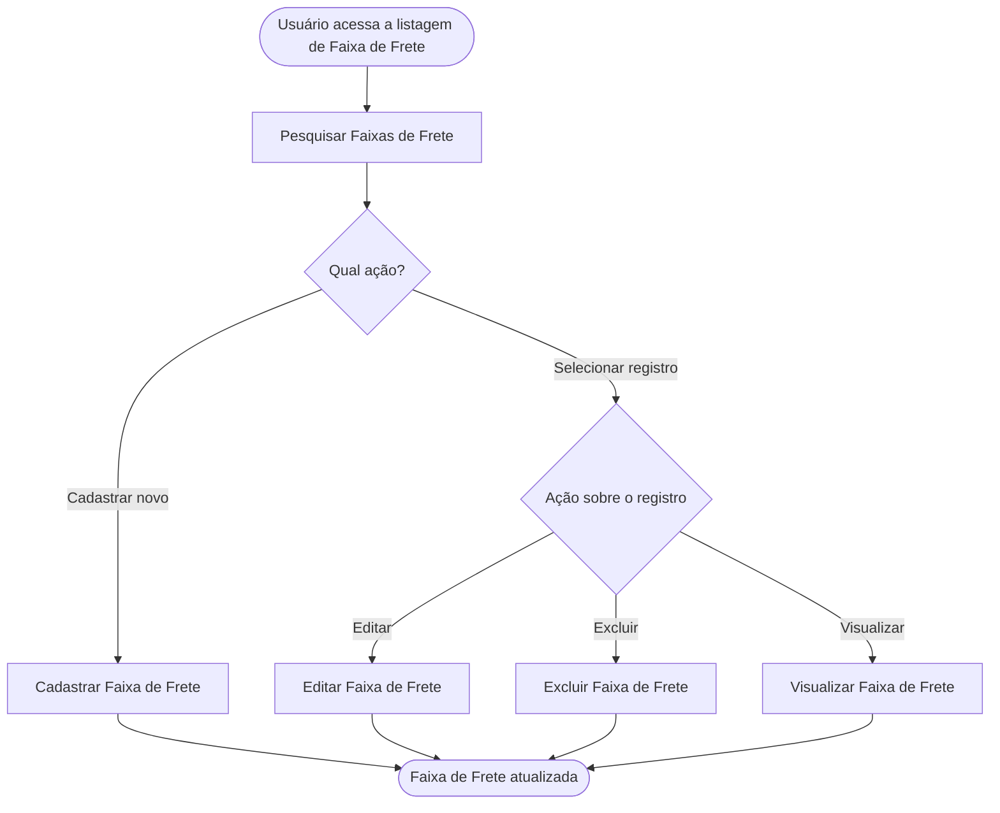

<!-- docqui: 6.4.10 | prompt: IDS_N3 | atualizado: 2026-10-18 -->
# Feature Set: Faixas de Frete
> **Nível 2** - Major Feature Set: Administração - `ADM-FRT`

## Descrição

Reúne as operações de manutenção das faixas de frete: pesquisar, cadastrar, editar, excluir e visualizar uma faixa de CEP com o valor da entrega. Permite ao administrador mudar a tabela de frete sem depender da equipe de sistemas, e ao atendente consultá-la para cotar o frete durante o atendimento.

**Não faz**: calcular o frete de um pedido (Checkout › Calcular Frete) nem definir o prazo de entrega (exercício STRY0013120).

## Features

<!-- docqui:n3-ids {"version":1,"ids":{"ADM-FRT-01":"f-pesquisar-faixa-frete.md","ADM-FRT-02":"f-cadastrar-faixa-frete.md","ADM-FRT-03":"f-editar-faixa-frete.md","ADM-FRT-04":"f-excluir-faixa-frete.md","ADM-FRT-05":"f-visualizar-faixa-frete.md"}} -->

| Feature | Descrição |
|---|---|
| [**Pesquisar Faixas de Frete**](f-pesquisar-faixa-frete.md) <small>ADM-FRT-01</small> | Encontrar faixas por região ou por um CEP que elas atendem |
| [**Cadastrar Faixa de Frete**](f-cadastrar-faixa-frete.md) <small>ADM-FRT-02</small> | Incluir uma faixa de CEP com o valor do frete |
| [**Editar Faixa de Frete**](f-editar-faixa-frete.md) <small>ADM-FRT-03</small> | Alterar o intervalo de CEP e o valor |
| [**Excluir Faixa de Frete**](f-excluir-faixa-frete.md) <small>ADM-FRT-04</small> | Remover uma faixa que não atende pedidos |
| [**Visualizar Faixa de Frete**](f-visualizar-faixa-frete.md) <small>ADM-FRT-05</small> | Ver todos os dados de uma faixa |

## Fluxo Principal

## Dependências entre features

- **Pesquisar Faixas de Frete** é o ponto de entrada; **Cadastrar Faixa de Frete** independe das demais.
- **Editar Faixa de Frete**, **Excluir Faixa de Frete** e **Visualizar Faixa de Frete** exigem uma faixa existente, alcançada pela pesquisa.
- **Excluir Faixa de Frete** depende de a faixa não atender pedidos (Pedido, de [Vendas](../../vendas/README.md)).
- As faixas mantidas aqui são as que **Calcular Frete** <small>VND-CHK-01</small>, do Feature Set [Checkout](../../vendas/checkout/README.md), usa.

## Telas

| Tela | Rota sugerida | Features atendidas | Descrição |
|---|---|---|---|
| Pesquisa de Faixas de Frete | `/administracao/faixas-frete` | **Pesquisar Faixas de Frete** <small>ADM-FRT-01</small> **Excluir Faixa de Frete** <small>ADM-FRT-04</small> | Filtros e lista das faixas; origem das ações |
| Cadastrar Faixa de Frete | `/administracao/faixas-frete/novo` | **Cadastrar Faixa de Frete** <small>ADM-FRT-02</small> | Formulário de cadastro |
| Editar Faixa de Frete | `/administracao/faixas-frete/:id/editar` | **Editar Faixa de Frete** <small>ADM-FRT-03</small> | Mesmo formulário em modo edição |
| Visualizar Faixa de Frete | `/administracao/faixas-frete/:id` | **Visualizar Faixa de Frete** <small>ADM-FRT-05</small> | Ficha somente leitura |

## Permissões por perfil

> **Fonte única de permissões** deste Feature Set. As features (N3) não tratam de perfis nem permissões; qualquer acesso novo ou diferente entra nesta matriz.

Perfis: **Administrador**, **Atendente**.

| Perfil | Pesquisar | Cadastrar | Editar | Excluir | Visualizar |
|---|---|---|---|---|---|
| **Administrador** | ✓ | ✓ | ✓ | ✓ | ✓ |
| **Atendente** | ✓ | — | — | — | ✓ |

* **Administrador** — mantém a tabela de frete.
* **Atendente** — consulta as faixas para cotar o frete durante o atendimento.

## Changelog

| Data | Autor | Tipo | Descrição |
|---|---|---|---|
| 2026-10-18 | ids-n3 | IDs reservados | Registro dos IDs existentes, sem renumeração; IDs imutáveis. |
| 2026-10-18 | Claude | N2 criado | CRUD de Faixas de Frete gerado pelo PROMPT CRUD a partir do ticket fictício STRY0013200; mantém a TabelaFrete de Vendas; sem aprovação de checkpoint. |

*Links: [N1 Administração](../README.md) · [INDEX geral](../../INDEX.md)*
