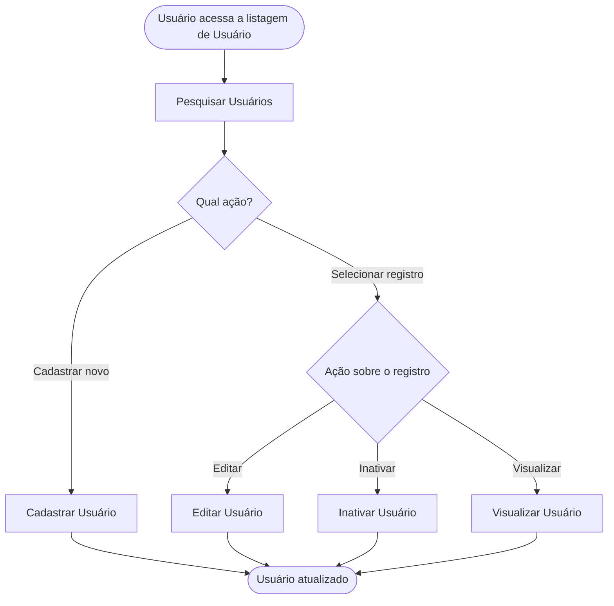

<!-- docqui: 6.4.10 | prompt: IDS_N3 | atualizado: 2026-10-18 -->
# Feature Set: Usuários
> **Nível 2** - Major Feature Set: Administração - `ADM-USR`

## Descrição

Reúne as operações de manutenção dos usuários da loja: pesquisar, cadastrar, editar, inativar e visualizar um usuário. Permite ao administrador definir quem acessa a loja e com que perfil, e tirar o acesso de alguém sem apagar o seu histórico.

**Não faz**: definir senha, dar o primeiro acesso nem reativar um usuário inativo; o autocadastro do cliente na loja também não está especificado.

## Features

<!-- docqui:n3-ids {"version":1,"ids":{"ADM-USR-01":"f-pesquisar-usuario.md","ADM-USR-02":"f-cadastrar-usuario.md","ADM-USR-03":"f-editar-usuario.md","ADM-USR-04":"f-inativar-usuario.md","ADM-USR-05":"f-visualizar-usuario.md"}} -->

| Feature | Descrição |
|---|---|
| [**Pesquisar Usuários**](f-pesquisar-usuario.md) <small>ADM-USR-01</small> | Encontrar usuários por nome, e-mail, perfil e situação |
| [**Cadastrar Usuário**](f-cadastrar-usuario.md) <small>ADM-USR-02</small> | Incluir um usuário com e-mail único e perfil |
| [**Editar Usuário**](f-editar-usuario.md) <small>ADM-USR-03</small> | Alterar os dados e o perfil, sem mudar o e-mail |
| [**Inativar Usuário**](f-inativar-usuario.md) <small>ADM-USR-04</small> | Tirar o acesso de um usuário, mantendo o histórico |
| [**Visualizar Usuário**](f-visualizar-usuario.md) <small>ADM-USR-05</small> | Ver todos os dados de um usuário |

## Fluxo Principal

## Dependências entre features

- **Pesquisar Usuários** é o ponto de entrada; **Cadastrar Usuário** independe das demais.
- **Editar Usuário**, **Inativar Usuário** e **Visualizar Usuário** exigem um usuário existente, alcançado pela pesquisa; editar e inativar exigem um usuário ativo.
- A exclusão é lógica: **Inativar Usuário** mantém o usuário nos pedidos em que ele é cliente ou em que cancelou (Pedido, de [Vendas](../../vendas/README.md)).

## Telas

| Tela | Rota sugerida | Features atendidas | Descrição |
|---|---|---|---|
| Pesquisa de Usuários | `/administracao/usuarios` | **Pesquisar Usuários** <small>ADM-USR-01</small> **Inativar Usuário** <small>ADM-USR-04</small> | Filtros e lista dos usuários; origem das ações |
| Cadastrar Usuário | `/administracao/usuarios/novo` | **Cadastrar Usuário** <small>ADM-USR-02</small> | Formulário de cadastro |
| Editar Usuário | `/administracao/usuarios/:id/editar` | **Editar Usuário** <small>ADM-USR-03</small> | Mesmo formulário em modo edição |
| Visualizar Usuário | `/administracao/usuarios/:id` | **Visualizar Usuário** <small>ADM-USR-05</small> | Ficha somente leitura |

## Permissões por perfil

> **Fonte única de permissões** deste Feature Set. As features (N3) não tratam de perfis nem permissões; qualquer acesso novo ou diferente entra nesta matriz.

Perfis: **Administrador**, **Atendente**, **Gestor de catálogo**, **Cliente**.

| Perfil | Pesquisar | Cadastrar | Editar | Inativar | Visualizar |
|---|---|---|---|---|---|
| **Administrador** | ✓ | ✓ | ✓ | ✓ | ✓ |
| **Atendente** | — | — | — | — | — |
| **Gestor de catálogo** | — | — | — | — | — |
| **Cliente** | — | — | — | — | — |

* **Administrador** — mantém os usuários da loja.

## Changelog

| Data | Autor | Tipo | Descrição |
|---|---|---|---|
| 2026-10-18 | ids-n3 | IDs reservados | Registro dos IDs existentes, sem renumeração; IDs imutáveis. |
| 2026-10-18 | Claude | N2 criado | CRUD de Usuários gerado pelo PROMPT CRUD a partir do ticket fictício STRY0013195; a exclusão é lógica (Inativar Usuário); sem aprovação de checkpoint. |

*Links: [N1 Administração](../README.md) · [INDEX geral](../../INDEX.md)*
