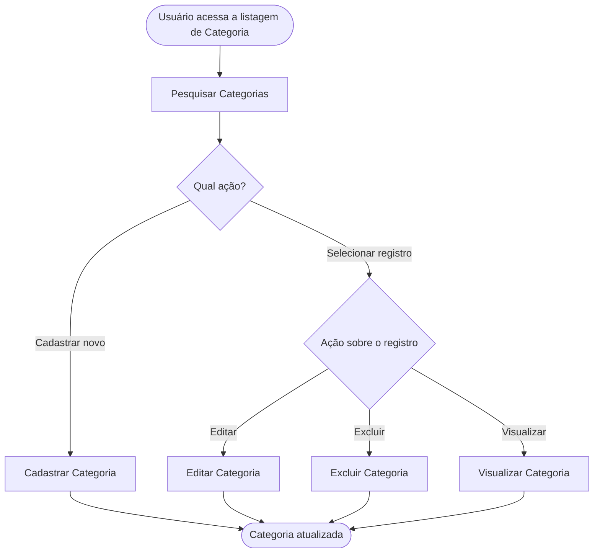

<!-- docqui: 7.0.0 | prompt: MIGRA_NIVEIS | atualizado: 2026-10-21 -->
# Agrupamento Funcional: Categorias
> **Nível 2** - Domínio: Catálogo - `CAT-CTG`

## Descrição

Reúne as operações de manutenção das categorias de produtos: pesquisar, cadastrar, editar, excluir e visualizar uma categoria. Permite ao gestor de catálogo organizar os produtos que a vitrine mostra e tirar uma categoria inteira da vitrine sem apagá-la.

**Não faz**: cadastrar produtos (Produtos, exercício STRY0013150) nem decidir o que aparece em destaque (Vitrine › Destaques).

## Funcionalidades

<!-- docqui:n3-ids {"version":1,"ids":{"CAT-CTG-01":"f-pesquisar-categoria.md","CAT-CTG-02":"f-cadastrar-categoria.md","CAT-CTG-03":"f-editar-categoria.md","CAT-CTG-04":"f-excluir-categoria.md","CAT-CTG-05":"f-visualizar-categoria.md"}} -->

| Funcionalidade | Descrição |
|---|---|
| [**Pesquisar Categorias**](f-pesquisar-categoria.md) <small>CAT-CTG-01</small> | Encontrar categorias por nome e situação |
| [**Cadastrar Categoria**](f-cadastrar-categoria.md) <small>CAT-CTG-02</small> | Incluir uma categoria com nome único |
| [**Editar Categoria**](f-editar-categoria.md) <small>CAT-CTG-03</small> | Alterar a descrição e a situação; o nome não muda |
| [**Excluir Categoria**](f-excluir-categoria.md) <small>CAT-CTG-04</small> | Remover uma categoria que não tem produtos |
| [**Visualizar Categoria**](f-visualizar-categoria.md) <small>CAT-CTG-05</small> | Ver todos os dados e quantos produtos a categoria tem |

## Fluxo Principal

## Dependências entre funcionalidades

- **Pesquisar Categorias** é o ponto de entrada; **Cadastrar Categoria** independe das demais.
- **Editar Categoria**, **Excluir Categoria** e **Visualizar Categoria** exigem uma categoria existente, alcançada pela pesquisa.
- **Excluir Categoria** depende de a categoria não ter produtos (Produto, do Catálogo). A categoria com produtos sai da vitrine ao ser inativada em **Editar Categoria**.

## Telas

| Tela | Rota sugerida | Funcionalidades atendidas | Descrição |
|---|---|---|---|
| Pesquisa de Categorias | `/catalogo/categorias` | **Pesquisar Categorias** <small>CAT-CTG-01</small> **Cadastrar Categoria** <small>CAT-CTG-02</small> **Editar Categoria** <small>CAT-CTG-03</small> **Excluir Categoria** <small>CAT-CTG-04</small> **Visualizar Categoria** <small>CAT-CTG-05</small> | Filtros e lista das categorias; cadastro, edição e visualização abrem em modal sobre a pesquisa, e a exclusão é ação na linha |

## Permissões por perfil

> **Fonte única de permissões** deste Agrupamento Funcional. As funcionalidades (N3) não tratam de perfis nem permissões; qualquer acesso novo ou diferente entra nesta matriz.

Perfis: **Gestor de catálogo**, **Administrador**.

| Perfil | Pesquisar | Cadastrar | Editar | Excluir | Visualizar |
|---|---|---|---|---|---|
| **Gestor de catálogo** | ✓ | ✓ | ✓ | ✓ | ✓ |
| **Administrador** | ✓ | — | — | — | ✓ |

* **Gestor de catálogo** — mantém as categorias.
* **Administrador** — consulta, sem alterar.

## Changelog

| Data | Autor | Tipo | Descrição |
|---|---|---|---|
| 2026-10-18 | ids-n3 | IDs reservados | Registro dos IDs existentes, sem renumeração; IDs imutáveis. |
| 2026-10-18 | Claude | N2 criado | CRUD de Categorias gerado pelo PROMPT CRUD a partir do ticket fictício STRY0013170; cadastro, edição e visualização em modal; sem aprovação de checkpoint. |
| 2026-10-21 | Docqui Caixa | Terminologia | Níveis em português: Domínio, Agrupamento Funcional e Funcionalidade; histórico preservado. |

*Links: [N1 Catálogo](../README.md) · [INDEX geral](../../INDEX.md)*
