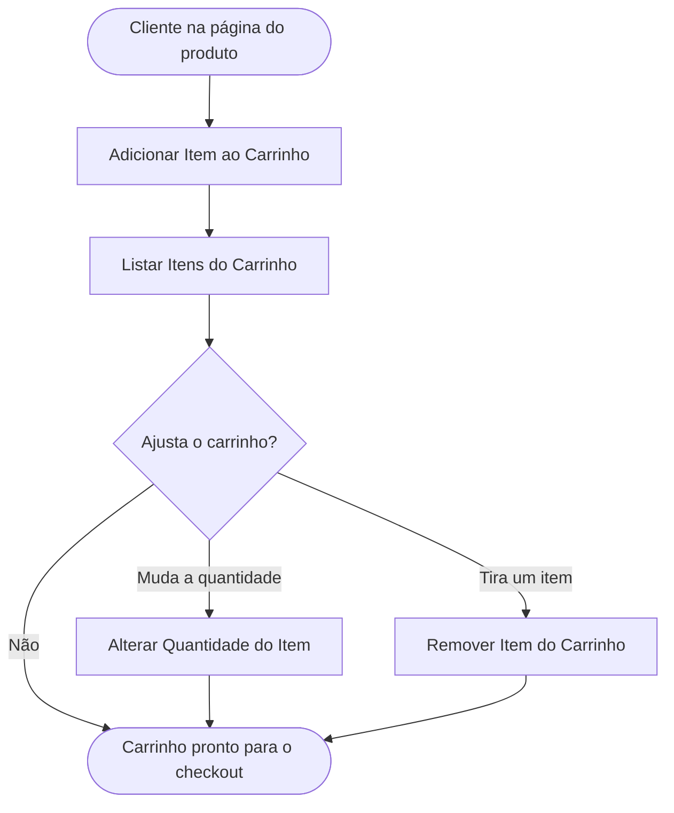

<!-- docqui: 6.4.10 | prompt: IDS_N3 | atualizado: 2026-10-18 -->
# Feature Set: Carrinho
> **Nível 2** - Major Feature Set: Vendas - `VND-CAR`

## Descrição

Reúne as operações do cliente sobre os itens escolhidos antes da compra: adicionar um produto ao carrinho, ver os itens com o total, alterar a quantidade de um item e removê-lo. Permite chegar ao checkout só com o que o cliente quer comprar, na quantidade que o estoque permite.

**Não faz**: calcular o frete nem confirmar o pedido (Checkout), mostrar os produtos (Vitrine) nem baixar o estoque.

## Features

<!-- docqui:n3-ids {"version":1,"ids":{"VND-CAR-01":"f-adicionar-item-carrinho.md","VND-CAR-02":"f-listar-item-carrinho.md","VND-CAR-03":"f-alterar-quantidade-item.md","VND-CAR-04":"f-remover-item-carrinho.md"}} -->

| Feature | Descrição |
|---|---|
| [**Adicionar Item ao Carrinho**](f-adicionar-item-carrinho.md) <small>VND-CAR-01</small> | Pôr um produto no carrinho, na quantidade escolhida |
| [**Listar Itens do Carrinho**](f-listar-item-carrinho.md) <small>VND-CAR-02</small> | Ver os itens, os subtotais e o total dos itens |
| [**Alterar Quantidade do Item**](f-alterar-quantidade-item.md) <small>VND-CAR-03</small> | Mudar a quantidade de um item do carrinho |
| [**Remover Item do Carrinho**](f-remover-item-carrinho.md) <small>VND-CAR-04</small> | Tirar um item do carrinho |

## Fluxo Principal

## Dependências entre features

- **Adicionar Item ao Carrinho** parte da página do produto (**Visualizar Produto na Vitrine** <small>VIT-NAV-03</small>, do Feature Set [Navegação](../../vitrine/navegacao/README.md)) e cria o carrinho quando o cliente ainda não tem um.
- **Listar Itens do Carrinho**, **Alterar Quantidade do Item** e **Remover Item do Carrinho** exigem um carrinho com itens.
- O checkout (**Calcular Frete** <small>VND-CHK-01</small>, do Feature Set [Checkout](../checkout/README.md)) começa de um carrinho com ao menos um item.

## Telas

| Tela | Rota sugerida | Features atendidas | Descrição |
|---|---|---|---|
| Página do produto | `/produtos/:id` | **Adicionar Item ao Carrinho** <small>VND-CAR-01</small> | Tela da Navegação, na Vitrine; a quantidade e o botão Adicionar ao carrinho |
| Carrinho | `/carrinho` | **Listar Itens do Carrinho** <small>VND-CAR-02</small> **Alterar Quantidade do Item** <small>VND-CAR-03</small> **Remover Item do Carrinho** <small>VND-CAR-04</small> | Itens, subtotais, total dos itens e o caminho para o checkout |

## Permissões por perfil

> **Fonte única de permissões** deste Feature Set. As features (N3) não tratam de perfis nem permissões; qualquer acesso novo ou diferente entra nesta matriz.

Perfis: **Cliente**, **Visitante**, **Atendente**.

| Perfil | Adicionar Item ao Carrinho | Listar Itens do Carrinho | Alterar Quantidade do Item | Remover Item do Carrinho |
|---|---|---|---|---|
| **Cliente** | ✓ | ✓ | ✓ | ✓ |
| **Visitante** | — | — | — | — |
| **Atendente** | — | — | — | — |

* **Cliente** — monta o próprio carrinho.
* **Visitante** — precisa se identificar como cliente para usar o carrinho; a identificação não está especificada no exemplo.
* **Atendente** — apoia o cliente pelo Checkout e pela Gestão de Pedidos, sem mexer no carrinho dele.

## Changelog

| Data | Autor | Tipo | Descrição |
|---|---|---|---|
| 2026-10-18 | ids-n3 | IDs reservados | Registro dos IDs existentes, sem renumeração; IDs imutáveis. |
| 2026-10-18 | Claude | N2 criado | Carrinho a partir do ticket fictício STRY0013185: o pedido aberto é o carrinho do cliente; sem aprovação de checkpoint. |

*Links: [N1 Vendas](../README.md) · [INDEX geral](../../INDEX.md)*
