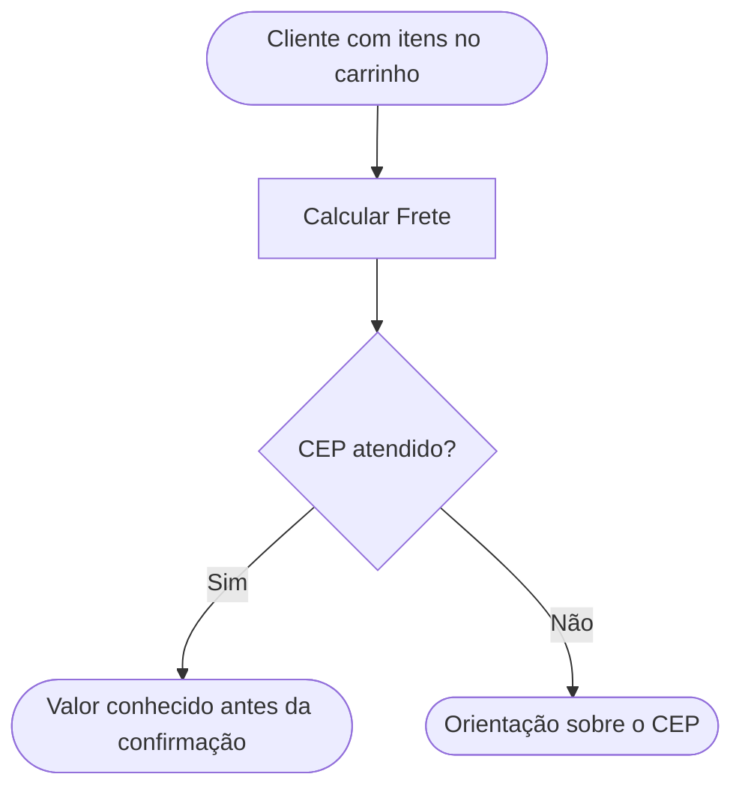

<!-- docqui: 6.4.10 | prompt: PROMPT_2A_N2_negocio | atualizado: 2026-10-18 -->
# Feature Set: Checkout
> **Nível 2** - Major Feature Set: Vendas - `VND-CHK`

## Descrição

Checkout é a etapa em que o cliente informa onde quer receber e consulta o valor da entrega antes de confirmar o pedido. O exemplo inicial cobre o cálculo do frete a partir das faixas de CEP locais.

**Não faz**: montar o carrinho, cobrar o pagamento nem executar a entrega.

## Features

| Feature | Descrição |
|---|---|
| [**Calcular Frete**](f-calcular-frete.md) <small>VND-CHK-01</small> | Consultar o valor da entrega pelo CEP |

## Fluxo Principal

## Dependências entre features

- Calcular Frete requer um carrinho com ao menos um item, montado por **Adicionar Item ao Carrinho** <small>VND-CAR-01</small>, do Feature Set [Carrinho](../carrinho/README.md).
- O valor vem das faixas mantidas em **Faixas de Frete** <small>ADM-FRT</small>, da [Administração](../../administracao/README.md).

## Telas

| Tela | Rota sugerida | Features atendidas | Descrição |
|---|---|---|---|
| Checkout | `/checkout` | **Calcular Frete** <small>VND-CHK-01</small> | CEP de entrega e resultado da cotação |

## Permissões por perfil

> **Fonte única de permissões** deste Feature Set. As features (N3) não tratam de perfis nem permissões; qualquer acesso novo ou diferente entra nesta matriz.

Perfis: **Cliente**, **Atendente**.

| Perfil | Calcular Frete |
|---|---|
| **Cliente** | ✓ |
| **Atendente** | ✓ |

## Changelog

| Data | Autor | Tipo | Descrição |
|---|---|---|---|
| 2026-10-14 | Copilot | N2 criado | Checkout didático com jornada e permissões, sem aprovação de checkpoint. |
| 2026-10-17 | Claude | Ajuste | Sai a coluna Prioridade da tabela de Features: a priorização das features saiu do método no engine 6.4.4. A ordem da tabela continua a da jornada. |
| 2026-10-18 | Claude | Ajuste | As dependências passam a citar o Carrinho, agora especificado (VND-CAR-01 — Adicionar Item ao Carrinho), e as Faixas de Frete da Administração, de onde vem o valor. Nenhuma feature, tela ou permissão muda. |

*Links: [Vendas](../README.md) · [INDEX geral](../../INDEX.md)*
