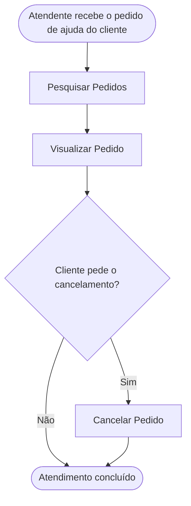

<!-- docqui: 7.0.0 | prompt: MIGRA_NIVEIS | atualizado: 2026-10-21 -->
# Agrupamento Funcional: Gestão de Pedidos
> **Nível 2** - Domínio: Vendas - `VND-PED`

## Descrição

Reúne as operações do atendimento sobre os pedidos já confirmados: pesquisar pedidos, ver o detalhe de um pedido e cancelá-lo. Permite ao atendente localizar o pedido de um cliente durante o atendimento e registrar o cancelamento com o motivo.

**Não faz**: alterar itens ou o endereço de um pedido, estornar pagamento nem reabrir um pedido cancelado.

## Funcionalidades

<!-- docqui:n3-ids {"version":1,"ids":{"VND-PED-01":"f-pesquisar-pedido.md","VND-PED-02":"f-visualizar-pedido.md","VND-PED-03":"f-cancelar-pedido.md"}} -->

| Funcionalidade | Descrição |
|---|---|
| [**Pesquisar Pedidos**](f-pesquisar-pedido.md) <small>VND-PED-01</small> | Encontrar pedidos por número, cliente, situação e período |
| [**Visualizar Pedido**](f-visualizar-pedido.md) <small>VND-PED-02</small> | Ver o cliente, os itens, a entrega, o frete e o total |
| [**Cancelar Pedido**](f-cancelar-pedido.md) <small>VND-PED-03</small> | Cancelar um pedido confirmado, com o motivo |

## Fluxo Principal

## Dependências entre funcionalidades

- **Pesquisar Pedidos** é o ponto de entrada e lista os pedidos confirmados e cancelados; o pedido aberto é o carrinho do cliente e não aparece aqui.
- **Visualizar Pedido** exige um pedido encontrado pela pesquisa.
- **Cancelar Pedido** parte do detalhe do pedido e exige um pedido confirmado.
- Os pedidos referenciam o cliente (Usuario, da [Administração](../../administracao/README.md)) e os produtos (Produto, do [Catálogo](../../catalogo/README.md)).

## Telas

| Tela | Rota sugerida | Funcionalidades atendidas | Descrição |
|---|---|---|---|
| Pesquisa de Pedidos | `/vendas/pedidos` | **Pesquisar Pedidos** <small>VND-PED-01</small> | Filtros e lista dos pedidos |
| Detalhe do Pedido | `/vendas/pedidos/:numero` | **Visualizar Pedido** <small>VND-PED-02</small> **Cancelar Pedido** <small>VND-PED-03</small> | Ficha do pedido, com os itens, e o botão Cancelar pedido |

## Permissões por perfil

> **Fonte única de permissões** deste Agrupamento Funcional. As funcionalidades (N3) não tratam de perfis nem permissões; qualquer acesso novo ou diferente entra nesta matriz.

Perfis: **Atendente**, **Administrador**.

| Perfil | Pesquisar Pedidos | Visualizar Pedido | Cancelar Pedido |
|---|---|---|---|
| **Atendente** | ✓ | ✓ | ✓ |
| **Administrador** | ✓ | ✓ | — |

* **Atendente** — atende o cliente e cancela o pedido quando ele pede.
* **Administrador** — acompanha os pedidos, sem cancelar.

## Changelog

| Data | Autor | Tipo | Descrição |
|---|---|---|---|
| 2026-10-18 | ids-n3 | IDs reservados | Registro dos IDs existentes, sem renumeração; IDs imutáveis. |
| 2026-10-18 | Claude | N2 criado | Gestão de Pedidos a partir do ticket fictício STRY0013190, com jornada, telas e permissões; sem aprovação de checkpoint. |
| 2026-10-21 | Docqui Caixa | Terminologia | Níveis em português: Domínio, Agrupamento Funcional e Funcionalidade; histórico preservado. |

*Links: [N1 Vendas](../README.md) · [INDEX geral](../../INDEX.md)*
