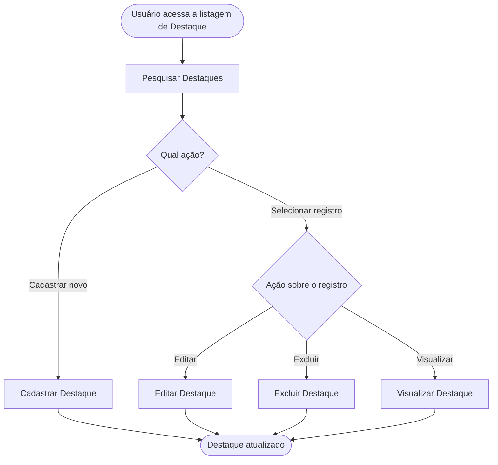

<!-- docqui: 6.4.10 | prompt: IDS_N3 | atualizado: 2026-10-18 -->
# Feature Set: Destaques
> **Nível 2** - Major Feature Set: Vitrine - `VIT-DST`

## Descrição

Reúne as operações de manutenção dos destaques da página inicial: pesquisar, cadastrar, editar, excluir e visualizar um destaque. Permite ao gestor de catálogo escolher quais produtos aparecem em evidência, com que chamada, em que ordem e por quanto tempo.

**Não faz**: mostrar os destaques a quem visita a loja (Navegação › Listar Destaques) nem alterar o preço ou o estoque do produto (Catálogo).

## Features

<!-- docqui:n3-ids {"version":1,"ids":{"VIT-DST-01":"f-pesquisar-destaque.md","VIT-DST-02":"f-cadastrar-destaque.md","VIT-DST-03":"f-editar-destaque.md","VIT-DST-04":"f-excluir-destaque.md","VIT-DST-05":"f-visualizar-destaque.md"}} -->

| Feature | Descrição |
|---|---|
| [**Pesquisar Destaques**](f-pesquisar-destaque.md) <small>VIT-DST-01</small> | Encontrar destaques por produto e situação |
| [**Cadastrar Destaque**](f-cadastrar-destaque.md) <small>VIT-DST-02</small> | Pôr um produto em destaque, com chamada, ordem e vigência |
| [**Editar Destaque**](f-editar-destaque.md) <small>VIT-DST-03</small> | Alterar a chamada, a ordem e a vigência |
| [**Excluir Destaque**](f-excluir-destaque.md) <small>VIT-DST-04</small> | Tirar um destaque da página inicial |
| [**Visualizar Destaque**](f-visualizar-destaque.md) <small>VIT-DST-05</small> | Ver todos os dados de um destaque |

## Fluxo Principal

## Dependências entre features

- **Pesquisar Destaques** é o ponto de entrada; **Cadastrar Destaque** independe das demais e escolhe um produto do [Catálogo](../../catalogo/README.md).
- **Editar Destaque**, **Excluir Destaque** e **Visualizar Destaque** exigem um destaque existente, alcançado pela pesquisa.
- Os destaques vigentes aparecem em **Listar Destaques** <small>VIT-NAV-01</small>, do Feature Set [Navegação](../navegacao/README.md).

## Telas

| Tela | Rota sugerida | Features atendidas | Descrição |
|---|---|---|---|
| Pesquisa de Destaques | `/vitrine/destaques` | **Pesquisar Destaques** <small>VIT-DST-01</small> **Excluir Destaque** <small>VIT-DST-04</small> | Filtros e lista dos destaques; origem das ações |
| Cadastrar Destaque | `/vitrine/destaques/novo` | **Cadastrar Destaque** <small>VIT-DST-02</small> | Formulário de cadastro |
| Editar Destaque | `/vitrine/destaques/:id/editar` | **Editar Destaque** <small>VIT-DST-03</small> | Mesmo formulário em modo edição |
| Visualizar Destaque | `/vitrine/destaques/:id` | **Visualizar Destaque** <small>VIT-DST-05</small> | Ficha somente leitura |

## Permissões por perfil

> **Fonte única de permissões** deste Feature Set. As features (N3) não tratam de perfis nem permissões; qualquer acesso novo ou diferente entra nesta matriz.

Perfis: **Gestor de catálogo**, **Administrador**.

| Perfil | Pesquisar | Cadastrar | Editar | Excluir | Visualizar |
|---|---|---|---|---|---|
| **Gestor de catálogo** | ✓ | ✓ | ✓ | ✓ | ✓ |
| **Administrador** | ✓ | — | — | — | ✓ |

* **Gestor de catálogo** — escolhe e mantém os destaques.
* **Administrador** — consulta, sem alterar.

## Changelog

| Data | Autor | Tipo | Descrição |
|---|---|---|---|
| 2026-10-18 | ids-n3 | IDs reservados | Registro dos IDs existentes, sem renumeração; IDs imutáveis. |
| 2026-10-18 | Claude | N2 criado | CRUD de Destaques gerado pelo PROMPT CRUD a partir do ticket fictício STRY0013180, com telas próprias; sem aprovação de checkpoint. |

*Links: [N1 Vitrine](../README.md) · [INDEX geral](../../INDEX.md)*
