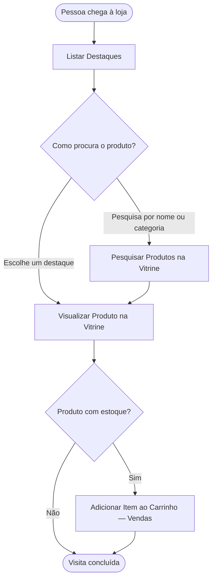

<!-- docqui: 6.4.10 | prompt: IDS_N3 | atualizado: 2026-10-18 -->
# Feature Set: Navegação
> **Nível 2** - Major Feature Set: Vitrine - `VIT-NAV`

## Descrição

Reúne o que a pessoa faz ao visitar a loja: ver os destaques da página inicial, pesquisar produtos por nome ou categoria e abrir a página de um produto. Permite encontrar o produto, o preço e a disponibilidade sem precisar se identificar.

**Não faz**: adicionar ao carrinho (Vendas › Carrinho), escolher os destaques (Destaques) nem manter produtos e categorias (Catálogo).

## Features

<!-- docqui:n3-ids {"version":1,"ids":{"VIT-NAV-01":"f-listar-destaque.md","VIT-NAV-02":"f-pesquisar-produto-vitrine.md","VIT-NAV-03":"f-visualizar-produto-vitrine.md"}} -->

| Feature | Descrição |
|---|---|
| [**Listar Destaques**](f-listar-destaque.md) <small>VIT-NAV-01</small> | Ver os produtos em destaque na página inicial |
| [**Pesquisar Produtos na Vitrine**](f-pesquisar-produto-vitrine.md) <small>VIT-NAV-02</small> | Encontrar produtos por nome e por categoria |
| [**Visualizar Produto na Vitrine**](f-visualizar-produto-vitrine.md) <small>VIT-NAV-03</small> | Ver a página do produto, com preço e disponibilidade |

## Fluxo Principal

## Dependências entre features

- **Listar Destaques** mostra os destaques mantidos em **Cadastrar Destaque** <small>VIT-DST-02</small>, do Feature Set [Destaques](../destaques/README.md).
- **Pesquisar Produtos na Vitrine** e **Listar Destaques** levam a **Visualizar Produto na Vitrine**.
- Da página do produto, o cliente segue para **Adicionar Item ao Carrinho** <small>VND-CAR-01</small>, do Feature Set [Carrinho](../../vendas/carrinho/README.md).
- As três features leem Produto e Categoria do [Catálogo](../../catalogo/README.md).

## Telas

| Tela | Rota sugerida | Features atendidas | Descrição |
|---|---|---|---|
| Página inicial | `/` | **Listar Destaques** <small>VIT-NAV-01</small> | Destaques vigentes e o campo de busca |
| Resultado da busca | `/produtos` | **Pesquisar Produtos na Vitrine** <small>VIT-NAV-02</small> | Busca por nome, filtro por categoria e a grade de produtos |
| Página do produto | `/produtos/:id` | **Visualizar Produto na Vitrine** <small>VIT-NAV-03</small> | Dados do produto, preço, disponibilidade e o botão que leva ao carrinho |

## Permissões por perfil

> **Fonte única de permissões** deste Feature Set. As features (N3) não tratam de perfis nem permissões; qualquer acesso novo ou diferente entra nesta matriz.

Perfis: **Visitante**, **Cliente**, **Atendente**, **Gestor de catálogo**, **Administrador**.

| Perfil | Listar Destaques | Pesquisar Produtos na Vitrine | Visualizar Produto na Vitrine |
|---|---|---|---|
| **Visitante** | ✓ | ✓ | ✓ |
| **Cliente** | ✓ | ✓ | ✓ |
| **Atendente** | ✓ | ✓ | ✓ |
| **Gestor de catálogo** | ✓ | ✓ | ✓ |
| **Administrador** | ✓ | ✓ | ✓ |

* A Navegação é aberta a qualquer pessoa, identificada ou não; por isso as features não têm cenário de restrição de acesso.

## Changelog

| Data | Autor | Tipo | Descrição |
|---|---|---|---|
| 2026-10-18 | ids-n3 | IDs reservados | Registro dos IDs existentes, sem renumeração; IDs imutáveis. |
| 2026-10-18 | Claude | N2 criado | Navegação da vitrine a partir do ticket fictício STRY0013175, com jornada, telas e permissões; sem aprovação de checkpoint. |

*Links: [N1 Vitrine](../README.md) · [INDEX geral](../../INDEX.md)*
